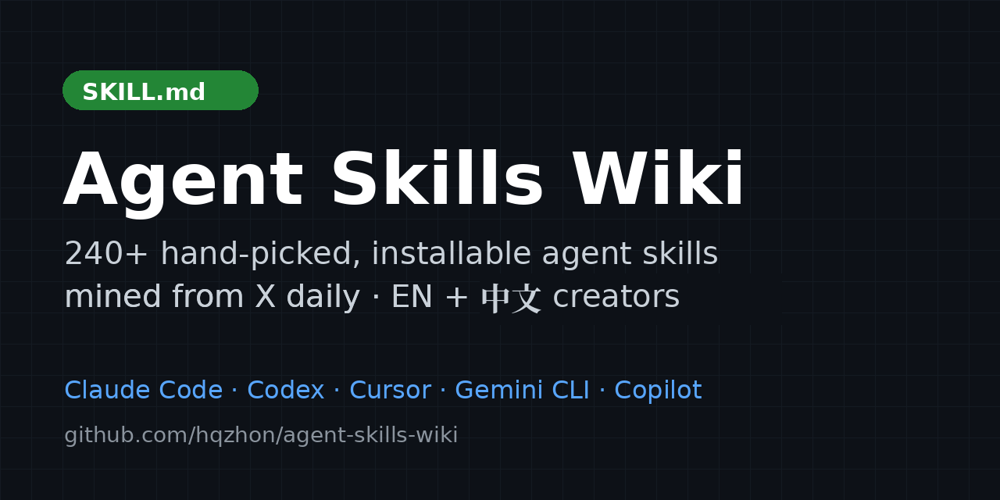

<!--
  Routine note: when new entries are added, update (1) the entry count in the badge and in "完整目录 Catalog（N 条）",
  (2) the "## 精选（按主题）· Picks by topic" bullets. Keep everything else as-is.
-->
<p align="center">
  
</p>

<h1 align="center">Agent Skills Wiki</h1>

<p align="center">
  <b>Hand-picked, installable agent skills (<code>SKILL.md</code>) for Claude Code, Codex, Cursor, Gemini CLI & more —<br>found on X within hours of launch, including the Chinese creator scene most English lists miss.</b><br>
  从 X 实时挖掘、人工筛过的 Agent Skills 百科：每条都有「何时用 / 怎么装 / 原帖出处 / 为何收录」。
</p>

<p align="center">
  <a href="wiki/Catalog.md"></a>
  
  
  <a href="CONTRIBUTING.md"></a>
  <a href="LICENSE"></a>
  <a href="https://github.com/hqzhon/agent-skills-wiki/stargazers"></a>
</p>

<p align="center">
  <a href="wiki/Catalog.md"><b>📚 Full Catalog</b></a> ·
  <a href="wiki/digests/"><b>🆕 Latest finds</b></a> ·
  <a href="#-top-picks"><b>⭐ Top picks</b></a> ·
  <a href="#-quick-start"><b>🚀 Quick start</b></a> ·
  <a href="#-submit-a-skill--推荐一个-skill"><b>➕ Submit a skill</b></a>
</p>

**[→ 打开完整目录 Catalog（478 条）](wiki/Catalog.md)** · **[最新扫描摘要](wiki/digests/)** · 每天 8:00 · 14:00 · 20:00（Asia/Shanghai）增量更新

---

## Why this list / 为什么值得 Star

| | |
| --- | --- |
| 🕒 **Fresh** | Scanned from X three times a day. New skills land here hours after their author tweets them — not weeks later. <br>每天 3 次扫 X，作者发帖几小时内收录。 |
| ✅ **Curated, not dumped** | Each entry passes a quality bar: a real use case, concrete steps or a `SKILL.md`, and something verifiable (repo / gist). Ads and hype are skipped. <br>只收可复用配方，广告和空喊一律跳过。 |
| 🔗 **Traceable** | Every entry links to the original post **and** the upstream repo, with install commands. <br>每条链回原帖 + 上游仓库 + 安装命令。 |
| 🌏 **EN + 中文** | Covers both the English and the Chinese AI-builder scene (李继刚, 宝玉, 花叔, 公众号/小红书 tooling…). <br>中英文创作者一起覆盖，很多中文好 skill 英文列表里没有。 |

**If this saves you time, a ⭐ helps others find it.** 觉得有用就点个 Star，让更多人看到。

---

## 🚀 Quick start

1. Pick a skill from the **[Catalog](wiki/Catalog.md)** or the tables below. Each entry page has *When to use · What it does · Install · Why it made the cut*.
2. Install it. Most skill repos work with the open [`skills` CLI](https://github.com/vercel-labs/skills):
   ```bash
   npx skills add <owner>/<repo>          # e.g. npx skills add blader/humanizer
   ```
   Or copy the skill folder (the one containing `SKILL.md`) into your agent's skills directory, e.g. `~/.claude/skills/` (Claude Code) or `~/.codex/skills/` (Codex). Repos that ship a Claude Code plugin can also be added with `/plugin marketplace add <owner>/<repo>`. The entry page lists the exact command when the upstream repo documents one.
3. Ask your agent to do the task — the skill loads when its description matches.

> 中文：在 Catalog 里挑一条 → 照条目页的安装命令装上（多数可 `npx skills add 作者/仓库`）→ 直接让 agent 干活即可。

---

## ⭐ Top picks

Most-starred skills in the wiki (GitHub stars as of 2026-11-27). 按 GitHub Star 排序的高信号精选。

| Skill | Repo | ★ | What it does |
| --- | --- | --- | --- |
| [Matt Pocock Skills](wiki/entries/mattpocock-skills.md) | [mattpocock/skills](https://github.com/mattpocock/skills) | 321k | Small, composable "skills for real engineers" |
| [Superpowers](wiki/entries/superpowers.md) | [obra/superpowers](https://github.com/obra/superpowers) | 316k | Brainstorm → plan → TDD delivery workflow |
| [ECC](wiki/entries/ecc.md) | [affaan-m/ECC](https://github.com/affaan-m/ECC) | 305k | Agent harness OS: skills, memory, hooks, review |
| [UI UX Pro Max](wiki/entries/ui-ux-pro-max.md) | [nextlevelbuilder/ui-ux-pro-max-skill](https://github.com/nextlevelbuilder/ui-ux-pro-max-skill) | 148k | Design-system intelligence for UI work |
| [gstack](wiki/entries/gstack.md) | [garrytan/gstack](https://github.com/garrytan/gstack) | 141k | Garry Tan's review / QA / shipping stack |
| [Addy Osmani Agent Skills](wiki/entries/addyosmani-agent-skills.md) | [addyosmani/agent-skills](https://github.com/addyosmani/agent-skills) | 116k | Engineering-lifecycle skill pack |
| [Taste Skill](wiki/entries/taste-skill.md) | [Leonxlnx/taste-skill](https://github.com/Leonxlnx/taste-skill) | 113k | Art direction for non-generic frontends |
| [Impeccable](wiki/entries/impeccable.md) | [pbakaus/impeccable](https://github.com/pbakaus/impeccable) | 108k | Frontend design vocabulary for agents |
| [HyperFrames](wiki/entries/hyperframes.md) | [heygen-com/hyperframes](https://github.com/heygen-com/hyperframes) | 89.6k | HeyGen official: render HTML to video + agent skills |
| [Humanizer](wiki/entries/humanizer.md) | [blader/humanizer](https://github.com/blader/humanizer) | 68k | Remove 26 patterns of AI-sounding writing |
| [last30days](wiki/entries/last30days-skill.md) | [mvanhorn/last30days-skill](https://github.com/mvanhorn/last30days-skill) | 67k | Research what Reddit / X / HN said in the last 30 days |
| [i-have-adhd](wiki/entries/i-have-adhd.md) | [ayghri/i-have-adhd](https://github.com/ayghri/i-have-adhd) | 62k | ADHD-friendly outputs: action first, no buried answers |
| [Marketing Skills](wiki/entries/marketingskills.md) | [coreyhaines31/marketingskills](https://github.com/coreyhaines31/marketingskills) | 60k | CRO, copywriting, SEO, customer research |
| [Chrome DevTools MCP](wiki/entries/chrome-devtools-mcp.md) | [ChromeDevTools/chrome-devtools-mcp](https://github.com/ChromeDevTools/chrome-devtools-mcp) | 59k | Official live-Chrome debugging MCP + 8 agent skills |
| [Open Code Review](wiki/entries/open-code-review.md) | [alibaba/open-code-review](https://github.com/alibaba/open-code-review) | 56.4k | Alibaba official hybrid code review CLI + agent skills |
| [agent-browser](wiki/entries/agent-browser.md) | [vercel-labs/agent-browser](https://github.com/vercel-labs/agent-browser) | 53.8k | Vercel Labs browser automation CLI for agents |
| [Obsidian Skills](wiki/entries/obsidian-skills.md) | [obsidianmd/obsidian-skills](https://github.com/obsidianmd/obsidian-skills) | 52k | Official Obsidian vault skills (Markdown, Bases, Canvas) |
| [OpenMAIC](wiki/entries/openmaic.md) | [THU-MAIC/OpenMAIC](https://github.com/THU-MAIC/OpenMAIC) | 44.6k | Tsinghua multi-agent interactive classroom + setup/extension skills |
| [VoltAgent Awesome Agent Skills](wiki/entries/voltagent-awesome-agent-skills.md) | [VoltAgent/awesome-agent-skills](https://github.com/VoltAgent/awesome-agent-skills) | 37.3k | Curated 1,497+ official & community agent skills |
| [HowToLiveLonger](wiki/entries/howtolivelonger.md) | [geekan/HowToLiveLonger](https://github.com/geekan/HowToLiveLonger) | 36.1k | Evidence-based longevity lookup for everyday habits |
| [Knowledge Work Plugins](wiki/entries/knowledge-work-plugins.md) | [anthropics/knowledge-work-plugins](https://github.com/anthropics/knowledge-work-plugins) | 35k | Anthropic's role-based skill plugins |
| [Vercel Agent Skills](wiki/entries/vercel-agent-skills.md) | [vercel-labs/agent-skills](https://github.com/vercel-labs/agent-skills) | 34.9k | Official React / Next.js / Vercel deploy and optimize skills |
| [Frontend Slides](wiki/entries/frontend-slides.md) | [zarazhangrui/frontend-slides](https://github.com/zarazhangrui/frontend-slides) | 32.9k | HTML decks from scratch or from PowerPoint, preview first |
| [video-use](wiki/entries/video-use.md) | [browser-use/video-use](https://github.com/browser-use/video-use) | 31k | Edit talking-head footage by chatting |
| [PM Skills](wiki/entries/pm-skills.md) | [phuryn/pm-skills](https://github.com/phuryn/pm-skills) | 28.3k | 72 PM decision skills / 9 plugins, companion to product-engineering |
| [planning-with-files](wiki/entries/planning-with-files.md) | [OthmanAdi/planning-with-files](https://github.com/OthmanAdi/planning-with-files) | 28.2k | Crash-proof markdown plans that survive /clear |
| [飞书 / Lark 官方 CLI Skills](wiki/entries/lark-cli-skills.md) | [larksuite/cli](https://github.com/larksuite/cli) | 18k | Official Feishu/Lark CLI + 26 agent skills |
| [no-ai-slop](wiki/entries/no-ai-slop.md) | [petergyang/no-ai-slop](https://github.com/petergyang/no-ai-slop) | 13.8k | Edit out AI-writing patterns, keep the author's voice |
| [figures4papers](wiki/entries/figures4papers.md) | [ChenLiu-1996/figures4papers](https://github.com/ChenLiu-1996/figures4papers) | 11.8k | Publication-quality Matplotlib figures + a loadable skill |
| [Hugging Face Skills](wiki/entries/huggingface-skills.md) | [huggingface/skills](https://github.com/huggingface/skills) | 11.4k | Official Hub / datasets / training skills, start with hf-cli |
| [scroll-world](wiki/entries/scroll-world.md) | [oso95/scroll-world](https://github.com/oso95/scroll-world) | 11.0k | Scroll-scrubbed 3D-world landing pages |
| [Dashi PPT Skill](wiki/entries/dashi-ppt-skill.md) | [chuspeeism/dashi-ppt-skill](https://github.com/chuspeeism/dashi-ppt-skill) | 10.7k | Browser-editable decks, export real PPTX |
| [Claude for Legal](wiki/entries/claude-for-legal.md) | [anthropics/claude-for-legal](https://github.com/anthropics/claude-for-legal) | 10.1k | Official legal workflow plugins / 157 skills |
| [improve](wiki/entries/shadcn-improve.md) | [shadcn/improve](https://github.com/shadcn/improve) | 10k | Strong model audits & plans, cheap model executes |
| [Guizang Social Card Skill](wiki/entries/guizang-social-card-skill.md) | [op7418/guizang-social-card-skill](https://github.com/op7418/guizang-social-card-skill) | 8.2k | Xiaohongshu carousels & WeChat cover pairs |
| [Social Media Research Skills](wiki/entries/social-media-research-skills.md) | [ScrapeCreators/social-media-research-skills](https://github.com/ScrapeCreators/social-media-research-skills) | 8.0k | Social research: outliers, comments, ads, trends (ScrapeCreators API) |
| [ljg-skills（李继刚）](wiki/entries/ljg-skills.md) | [lijigang/ljg-skills](https://github.com/lijigang/ljg-skills) | 7.7k | 26 atomic thinking / writing skills (中文) |
| [MengTo Skills](wiki/entries/mengto-skills.md) | [MengTo/Skills](https://github.com/MengTo/Skills) | 7.7k | Design+Code skill pack: HTML demos, 3D, illustration |
| [.NET Agent Skills](wiki/entries/dotnet-skills.md) | [dotnet/skills](https://github.com/dotnet/skills) | 5.9k | Official C# / MSBuild / NuGet skills with public evals |
| [Blender Skills（arjun988）](wiki/entries/blender-skills-arjun.md) | [arjun988/blender-skills](https://github.com/arjun988/blender-skills) | 5.0k | 94 Blender MCP skills from blockout to engine export |
| [Seedance 2.0 Prompt Skill](wiki/entries/seedance2-skill.md) | [dexhunter/seedance2-skill](https://github.com/dexhunter/seedance2-skill) | 4.6k | Prompt writing for Jimeng Seedance 2.0, EN/ZH SKILL.md |
| [wechat-selkies](wiki/entries/wechat-selkies.md) | [nickrunning/wechat-selkies](https://github.com/nickrunning/wechat-selkies) | 4.5k | Docker WeChat/QQ desktop plus an agent skill to operate it |
| [sprite-gen](wiki/entries/sprite-gen.md) | [aldegad/sprite-gen](https://github.com/aldegad/sprite-gen) | 4.3k | One still image to a game-ready sprite atlas or transparent loops |
| [gzh-design-skill](wiki/entries/gzh-design-skill.md) | [isjiamu/gzh-design-skill](https://github.com/isjiamu/gzh-design-skill) | 4.3k | Markdown → WeChat 公众号-ready HTML (中文) |
| [Effective HTML](wiki/entries/effective-html.md) | [plannotator/effective-html](https://github.com/plannotator/effective-html) | 4.2k | HTML wireframes, prototypes, diagrams, one-pagers |
| [Modern Web Guidance](wiki/entries/modern-web-guidance.md) | [GoogleChrome/modern-web-guidance](https://github.com/GoogleChrome/modern-web-guidance) | 4.0k | Chrome + Edge + Firefox + MDN: use modern web APIs |

---

## 精选（按主题）· Picks by topic

> 以下为 Catalog 中近期高信号 / 官方包摘录。完整列表 → **[Catalog](wiki/Catalog.md)**

### 官方 / 厂商包
- [Meta VR Agentic Tools（官方）](wiki/entries/meta-vr-agentic-tools.md) — Quest / Horizon OS 开发技能 + metavr CLI / MCP（255★，Apache-2.0；仓最近推送停在 2026-09-24）
- [Safe Agent Skills（Safe 官方）](wiki/entries/safe-agent-skills.md) — 只读 Safe 状态、解码 calldata 并提出交易，不能代签（1★，MIT）
- [gemini-frontend-design（Google 官方）](wiki/entries/gemini-frontend-design.md) — 按主题定制视觉方向、渲染后自检的前端设计 skill
- [ECMWF Weather Skills（官方）](wiki/entries/ecmwf-weather-skills.md) — 预报 / ERA5 / Destination Earth / MARS 等天气数据技能 + 可选 MCP（23★，Apache-2.0；项目标为 Emerging）
- [Wallet Theft Detective（GoPlus 官方）](wiki/entries/wallet-theft-detective.md) — 只读排查加密资产被盗可能原因，不读私钥或钱包文件（5★；许可未在 GitHub 明确标出）
- [Science Skills（Google DeepMind 官方）](wiki/entries/science-skills.md) — 文献库 / 蛋白与基因组公共库 / AlphaGenome 等约 40 个科研技能（3,536★，Apache-2.0；部分需 API key）
- [Open Code Review（阿里官方）](wiki/entries/open-code-review.md) — 确定性规则 + LLM 的行级代码审查 CLI 与两种 Agent Skill（56,426★，Apache-2.0；需 ocr CLI / 模型端点）
- [Gemma Skills](wiki/entries/gemma-skills.md) — Gemma 4 应用开发与微调（LoRA/QLoRA/DPO/GRPO）；仓库在 google-gemma 下，但 README 写明不是 Google 官方支持的产品（1,074★；根目录无 LICENSE）
- [gh（GitHub CLI 官方）](wiki/entries/gh-cli-skill.md) — agent 正确用 `gh`：JSON 输出、分页、`gh api` 兜底
- [Modern Web Guidance（浏览器厂商官方）](wiki/entries/modern-web-guidance.md) — 让编码 agent 用原生 Web API，附 legacy-scan
- [improve（shadcn）](wiki/entries/shadcn-improve.md) — 强模型审计写计划、便宜模型执行
- [.NET Agent Skills（官方）](wiki/entries/dotnet-skills.md) — C# / MSBuild / 升级迁移，附公开评测看板
- [NestJS Agent Skills（官方）](wiki/entries/nestjs-agent-skills.md) — 6 个技能按当前 Nest API 写接口/认证/数据/测试/上线（145★，MIT；本窗新发布）
- [Mapbox Agent Skills（官方）](wiki/entries/mapbox-agent-skills.md) — Web / iOS / Android / Flutter 地图开发技能 + Mapbox MCP（87★，MIT）
- [vela-agent-skills（LuxAlgo 官方）](wiki/entries/vela-agent-skills.md) — 金融图表库自带 6 个 skill + llms.txt，避免模型编过时 API（1,378★，Apache-2.0）
- [Meteor Agent Skills（官方）](wiki/entries/meteor-agent-skills.md) — Meteor 3 开发与迁移 17 技能
- [last30days](wiki/entries/last30days-skill.md) — 近 30 天 Reddit / X / Polymarket 真实讨论调研
- [Gemini API Skills（Google 官方）](wiki/entries/gemini-skills.md) — Gemini API / 媒体生成 CLI
- [Expo Skills（官方）](wiki/entries/expo-skills.md) — React Native / EAS
- [Vercel Agent Skills（官方技能包）](wiki/entries/vercel-agent-skills.md) — React / Next.js 性能规则、Vercel 部署与成本审计（34,881★；与 skills CLI、agent-browser 不是同一个仓）
- [Hugging Face Skills（官方）](wiki/entries/huggingface-skills.md) — 先装 hf-cli，再按需加数据集/训练/Spaces 技能（11,397★，Apache-2.0）
- [Cloudflare Skills（官方）](wiki/entries/cloudflare-skills.md) — Workers / Agents SDK / Wrangler，插件可带 MCP（3,450★，Apache-2.0）
- [Microsoft Skills（Azure / Foundry 官方）](wiki/entries/microsoft-skills.md) — 约 175 个 Azure SDK / Foundry 技能，有文档站（3,245★，MIT；与 APM、SkillOpt 互补）
- [Supabase Agent Skills（官方）](wiki/entries/supabase-agent-skills.md) — Auth / RLS / Edge Functions 等 + Postgres 实践（3,136★，MIT）
- [HashiCorp Agent Skills（官方）](wiki/entries/hashicorp-agent-skills.md) — Terraform 16 + Packer 4（939★，MPL-2.0）
- [Firebase Agent Skills（官方）](wiki/entries/firebase-agent-skills.md) — Auth / Firestore / Analytics / Rules 等 14 个技能（529★，Apache-2.0）
- [NVIDIA Agent Skills（官方）](wiki/entries/nvidia-skills.md) — CUDA / Physical AI
- [Loom Skills（AMD Loom）](wiki/entries/loom-skills.md) — 在 Strix Halo 等设备上移植/优化模型并对照 llama.cpp 测速
- [global-stock-data](wiki/entries/global-stock-data.md) — 美股/港股等公开数据工具包（官方源优先、零鉴权，~1881★）；内嵌 Python 会联网，先审权限
- [financial-statements（Anthropic 官方）](wiki/entries/anthropic-financial-statements.md) — 按期间整理三张表和差异分析，不编行情
- [xlsx-author（Anthropic 官方）](wiki/entries/anthropic-xlsx-author.md) — headless 生成可复核的 Excel 文件
- [claude-bughunter](wiki/entries/claude-bughunter.md) — 授权漏洞狩猎 / 红队技能包（83 个 skill，~5858★）
- [Google Cloud Skills（官方）](wiki/entries/google-cloud-skills.md) — IAM Helper 等
- [Chrome DevTools MCP（官方）](wiki/entries/chrome-devtools-mcp.md) — 实况 Chrome 调试 MCP + 8 个 skill（LCP / 无障碍 / Cookie / 内存泄漏，59k★，Apache-2.0；默认采集用量统计，可关闭）
- [RoboDK Agent Skills（官方）](wiki/entries/robodk-agent-skills.md) — 用自然语言搭工位、写 API、生成机器人程序（10★，MIT；仓最近推送停在 2026-10-06）
- [Google Cloud HPC Skills（官方 gke-batch-hpc）](wiki/entries/google-cloud-hpc.md) — GKE 批处理/HPC 队列、MPI、Kueue；SC26 与 Cluster Toolkit 配对（约 24.4k★）
- [Google Workspace CLI Skills（gws）](wiki/entries/google-workspace-cli-skills.md) — Gmail/Calendar/Drive 等 ~95 skills
- [飞书 / Lark 官方 CLI Agent Skills](wiki/entries/lark-cli-skills.md) — 200+ 命令 + 26 个飞书办公 skill，可 dry-run
- [Remotion Agent Skills（官方）](wiki/entries/remotion-skills.md) — React 视频创作与渲染
- [Remocn](wiki/entries/remocn.md) — 从约 935 个 MIT 组件做 Remotion 演示/发布视频，先分镜再写代码（1,869★，MIT；公司规模 >3 人需 Remotion 付费许可）
- [ElevenLabs Skills（官方）](wiki/entries/elevenlabs-skills.md) — 语音 / 实时音频
- [Anthropic Knowledge Work Plugins](wiki/entries/knowledge-work-plugins.md) — Cowork 角色技能包
- [Claude for Legal（Anthropic 官方）](wiki/entries/claude-for-legal.md) — 12 个法律插件 / 约 157 个技能；输出仅为供律师复核的草稿（10,078★，Apache-2.0）
- [You.com Agent Skills（官方）](wiki/entries/youdotcom-agent-skills.md) — 实时网页搜索 / 抽取 / 带引用调研与财经技能（108★，MIT；基础搜索可用免费 MCP profile）
- [Weaviate Agent Skills（官方）](wiki/entries/weaviate-agent-skills.md) — 查询/管理 Weaviate 向量库与导入数据（104★，BSD-3-Clause）
- [Oxylabs Web API Skills（官方）](wiki/entries/oxylabs-web-api-skills.md) — 实时网页搜索与读页，需 Oxylabs Web API key（14★，MIT；商业 API）
- [agent-browser（Vercel Labs）](wiki/entries/agent-browser.md) — 给 agent 用的浏览器自动化 CLI + 配套 skills（53,798★，Apache-2.0）
- [HyperFrames（HeyGen 官方）](wiki/entries/hyperframes.md) — 把 HTML 渲染成片的官方技能/工具（89,560★，Apache-2.0）
- [CF Daml Skill（Canton Foundation DevRel）](wiki/entries/cf-daml-skill.md) — Canton Network 上编写/审阅 Daml 合约，v2.0.0 覆盖 3.5–3.7（4★，Apache-2.0）
- [Microsoft SkillOpt](wiki/entries/microsoft-skillopt.md) — 训 Skill.md、不动权重
- [PixiJS Skills（官方）](wiki/entries/pixijs-skills.md) · [Android Official Skills](wiki/entries/android-official-skills.md) · [Compose Skill（Jetpack Compose 七件套）](wiki/entries/compose-skill.md)
- [Tailscale Skill（官方）](wiki/entries/tailscale-skill.md) — networking / tsnet / k8s
- [h3-image-prompt-writing（MiniMax 官方）](wiki/entries/minimax-h3-image-prompt-writing.md) — 一句想法扩写成 H3-Image 长提示词，可直接调 API 出图
- [Stitch Skills（Google Labs 官方）](wiki/entries/stitch-skills.md) — 配合 Stitch MCP 出设计再出 React/RN 代码（16 个 skill，~9447★）；仓最近推送停在 2026-08-17
- [Motion Design Skill（LottieFiles 官方）](wiki/entries/motion-design-skill.md) — 实现无关的 UI 动效原则：时长/缓动/迪士尼 12 原则与编排配方（3,206★，MIT；仓最近推送停在 2026-05-18）
- [First Principles Tutor](wiki/entries/first-principles-tutor.md) — 不给现成答案，用第一性原理逼你自己重建概念（6★，MIT；与 Jane Street 家教包不是同一仓库）
- [Jane Street Socratic Tutor（官方）](wiki/entries/janestreet-agent-skills.md) — 苏格拉底式家教：诊断、0–5 技能图、间隔复习
- [FlyAI（飞猪官方旅行搜索）](wiki/entries/flyai-skill.md) — 自然语言查机票/酒店/火车，结构化可预订结果
- [campus-recruiting-skill](wiki/entries/campus-recruiting-skill.md) — 中国非技术岗校招：核岗/简历/面试/Offer（不代投）
- [kr-career-skill](wiki/entries/kr-career-skill.md) — 韩国就业/跳槽：找匹配职位、公司分析、自荐草稿（不代投；新建仓，14★）
- [Itential Infrastructure Agent Skills（官方）](wiki/entries/itential-infra-agent-skills.md) — 40 个网络/基础设施操作技能、153 份厂商参考（Apache-2.0；新公开推广，1★）

- [equity-research（Anthropic × LSEG）](wiki/entries/anthropic-lseg-equity-research.md) — 一致预期 + 基本面 + 价格 + 宏观的研究快照（需 LSEG MCP）
- [dcf-model（Anthropic 官方）](wiki/entries/anthropic-dcf-model.md) — SEC + 研报取数，公式化 DCF 与敏感性分析
- [audit-xls（Anthropic 官方）](wiki/entries/anthropic-audit-xls.md) — 选区到整本模型的公式与勾稽审计，先报告不擅自改表
- [3-statement-model（Anthropic 官方）](wiki/entries/anthropic-3-statement-model.md) — 在已有模板里用公式填通三张表，禁止把算死的数字写入预测格
- [earnings-analysis（Anthropic 官方）](wiki/entries/anthropic-earnings-analysis.md) — 已覆盖公司的季报更新备忘（8–12 页，强制可点击引用）
- [ib-check-deck（Anthropic 官方）](wiki/entries/anthropic-ib-check-deck.md) — 路演/投资者演示稿只读质检：跨页数字、叙事与图表、语域和版式
- [thesis-tracker（Anthropic 官方）](wiki/entries/anthropic-thesis-tracker.md) — 组合/观察名单投资论点跟踪：支柱、催化剂、否决条件
- [Claude Trading Skills](wiki/entries/claude-trading-skills.md) — 74 个长线投资 + 波段流程技能（非自动下单，~4804★）
- [郑希观点库（zhengxi-views）](wiki/entries/zhengxi-views.md) — 可溯源检索易方达基金经理郑希的公开观点、方法与持仓，并可按该框架对比基金（1,778★；代码 MIT，仅供研究学习，非投资建议）

### 设计 / UI / 品味
- [sepia（去 AI 味写作）](wiki/entries/sepia.md) — 叙事架构层去 AI 味
- [Humanizer（blader）](wiki/entries/humanizer.md) — 26 种 AI 写作痕迹改写，~67k★ · 日语版思路见 [yomiyasu](wiki/entries/yomiyasu.md)
- [UX Writing Skill](wiki/entries/ux-writing-skill.md) — 按钮/错误/空状态等界面微文案框架（268★，MIT；与 ux-audit 分工不同）
- [ai-writing](wiki/entries/ai-writing.md) — 先砍篇幅和清晰度，再去 AI 腔（与 Humanizer 互补）
- [gzh-design-skill](wiki/entries/gzh-design-skill.md) — Markdown 一键排成公众号可粘贴 HTML，6 套主题
- [Taste Skill](wiki/entries/taste-skill.md) — 艺术指导 + 去 AI 味前端
- [antialgorithm](wiki/entries/antialgorithm.md) — 先点名模型的第一平均解，再按项目上下文离开它（707★，MIT）
- [baoyu-design / Open Artifact（本地 Claude Design）](wiki/entries/baoyu-design.md) — 幻灯片 / Dashboard / HTML；项目已重建为 JimLiu/open-artifact
- [Impeccable](wiki/entries/impeccable.md) — 前端设计词汇表
- [ip-as-logo](wiki/entries/ip-as-logo.md) — 极简 IP 吉祥物 Logo：三方向、六候选、严格复杂度预算
- [Logo Design Skill](wiki/entries/logo-design-skill.md) — brief 到可交付 SVG 标识与套件，附 1,400+ 参考库（只学习不复制；7,675★，MIT）
- [Frontend Slides](wiki/entries/frontend-slides.md) — 先出视觉预览再生成可离线打开的 HTML 幻灯片，也可转 PPT（32,869★，MIT；仓最近推送停在 2026-06-23）
- [unslop](wiki/entries/unslop.md) — 把 vibecoded 的 AI 味 UI 逐轮改成有性格的设计
- [unslop-ui](wiki/entries/unslop-ui.md) — 1.0 起只需贴仓库链接：按编号规则去掉界面/图表里的 AI 痕迹（含默认去掉卡片边缘粗色条），建完一屏后也可自行触发（867★，MIT；与 heydamir/unslop 互补）
- [unslop-anything](wiki/entries/unslop-anything.md) — 先查真实差评里的 UX 故障，再修 Web/移动端的 AI 味界面（358★，MIT；与 unslop、unslop-ui 不是同一仓库）
- [no-ai-slop](wiki/entries/no-ai-slop.md) — 去写作 AI 味并保留个人声音，可只检测不重写（13,773★，MIT；针对文案，不是 UI）
- [Guizang Social Card Skill](wiki/entries/guizang-social-card-skill.md) — 小红书图文 / 公众号 21:9+1:1 封面对（8,249★，AGPL-3.0）
- [User Interview Guide skill](wiki/entries/user-interview-skill.md) — 把学习目标写成中性的 1:1 访谈提纲（118★，Apache-2.0）
- [open-diagram](wiki/entries/open-diagram.md) — 会测量标签并自检布局的架构图 / 系统图，输出 SVG/PNG（373★，MIT）
- [UI UX Pro Max](wiki/entries/ui-ux-pro-max.md) — 设计系统智能技能 + CLI
- [oil-ui](wiki/entries/oil-ui.md) — UI 方向探索与并排对比
- [Emil Kowalski Skills](wiki/entries/emilkowalski-skills.md) — UI / 动效 taste
- [jakubkrehel/skills（Interface Skills）](wiki/entries/jakubkrehel-skills.md) — a11y / 字体 / 布局
- [Apple Human Interface Skills](wiki/entries/apple-human-interface-skills.md) — Apple HIG
- [Apple App Intents Skill](wiki/entries/apple-app-intents-skill.md) — 给 iOS 应用加 App Intents / Siri / Shortcuts / App Schemas（9★，MIT）
- [design-apps-with-imagegen（swyx）](wiki/entries/design-apps-with-imagegen.md) — 图像探索 → 真实现产品
- [garden-skills（ConardLi）](wiki/entries/garden-skills.md) — 网页设计 / RAG / 生图 / 动效小花园
- [萝卜 PPT](wiki/entries/luobo-ppt.md) — 生成 / 照参考图美化原生可编辑 PPTX
- [GordenPPTSkill](wiki/entries/gorden-ppt-skill.md) — 中文商务模板 + 只改文字（非商业许可）
- [Dashi PPT Skill（大师 PPT）](wiki/entries/dashi-ppt-skill.md) — 浏览器逐页改稿，导出可编辑 PPTX（AGPL-3.0）
- [PPT Agent Skill](wiki/entries/ppt-agent-skill.md) — 一句话调研后出 HTML 预览和可编辑 PPTX，26 风格 / 18 图表（217★，MIT）
- [Kubai Icons](wiki/entries/kubai-icons.md) — 统一画风动态/静态功能图标 skill + 2600+ 开源图标
- [Awesome Design Skills](wiki/entries/awesome-design-skills.md) — 67 套设计系统 SKILL.md + DESIGN.md（npx 拉取）
- [design.how](wiki/entries/design-how.md) — 从已有应用 UI 搭建并迁移设计系统，默认写在 run branch（453★）
- [Motion Design Skill（LottieFiles 官方）](wiki/entries/motion-design-skill.md) — 先按原则选时长/缓动/编排，再写 CSS/Motion/GSAP/Lottie 等实现（3,206★）
- [claude-drawing-skill](wiki/entries/claude-drawing-skill.md) — 不用生图模型，numpy + Pillow 在 CPU 上按 83 种画风作画，可回放作画过程（260★，MIT）
- [Stageshow](wiki/entries/stageshow.md) — 像真产品的假 UI 插画 / 光标演示
- [stack-diagram](wiki/entries/stack-diagram.md) · [svg-diagram](wiki/entries/svg-diagram.md) — 架构图 / SVG 图解（带 lint 自检）
- [Floorplan](wiki/entries/floorplan.md) — 从真实代码画出大白话交互地图
- [Effective HTML](wiki/entries/effective-html.md) — 8 个自包含 HTML 产物技能：线框 / 原型 / 一页纸 / 图解（4,194★，MIT）
- [scroll-world](wiki/entries/scroll-world.md) — 滚动穿越 3D 世界落地页（生成镜头链 + scrub 引擎，11,029★；需付费视频 API，与 scroll-craft 互补）
- [line-art-animation](wiki/entries/line-art-animation.md) — SVG 线描动画 skill + 无依赖 TypeScript 库（920★，MIT）
- [Spine Animation AI](wiki/entries/spine-animation-ai.md) — 从角色素材自动绑定并生成 Spine 2D 骨骼动画（786★，PolyForm Noncommercial，商用需另授权）
- [MengTo Skills](wiki/entries/mengto-skills.md) — Design+Code 作者的设计师/前端技能包，约 177 个 SKILL.md；本窗点名 html-demo（7,671★，MIT）
- [flawless-ui-ux](wiki/entries/flawless-ui-ux.md) — 按产品语境做网页/手机/桌面界面，并带本地检查 CLI（248★，MIT）
- [hairline](wiki/entries/hairline.md) — 等距单线插画：按想法生成或从 SVG 领养，交出自包含 HTML（4,015★，MIT）

### 工程 / 交付 / Meta
- [fuck-u-code-analysis](wiki/entries/fuck-u-code-analysis.md) — 提交前跑屎山体检，按 11 项指标给重构建议
- [gstack（Garry Tan）](wiki/entries/gstack.md) — review / QA / shipping
- [pstack `/statechart`](wiki/entries/pstack-statechart.md) — TLA+ 状态图找 bug
- [next-bundle-optimizer](wiki/entries/next-bundle-optimizer.md) — Next.js 官方捆包优化
- [nuxt-explicit-imports（Anthony Fu）](wiki/entries/nuxt-explicit-imports.md) — Nuxt 4 自动导入迁到显式 import：warn → 分目录迁移自检 → strict（新建仓，6★，MIT）
- [App Store Connect CLI Skills（asc）](wiki/entries/app-store-connect-cli-skills.md) — TestFlight / 元数据 / 提交审核等约 25 个发版 skill
- [app-store-compliance](wiki/entries/app-store-compliance.md) — App Store / Google Play 拒审预检与提交前 hook（4,170★，OpenRoots ORA 2.3，装前先看许可；与 cleared-for-takeoff 互补）
- [llm-council](wiki/entries/llm-council-skill.md) — 五个视角不同的顾问匿名互评后再给结论（Karpathy LLM Council；1,065★；仓库较久未更新且未标许可证）
- [Webcrawl Anything](wiki/entries/webcrawl-anything.md) — 本地免 Key 抓取 / 8 个 agent skills + CLI/MCP
- [Graphify](wiki/entries/graphify.md) — 本地 AST 知识图谱 CLI
- [skill-diet](wiki/entries/skill-diet.md) — 给臃肿 Skill 减重（token ↓）
- [planning-with-files](wiki/entries/planning-with-files.md) — 计划/发现/进度落盘，`/clear` 后仍可续上（28.2k★，MIT）
- [PM Skills](wiki/entries/pm-skills.md) — 72 个产品决策技能 / 9 个插件（28.3k★，MIT）；与已收录的 [product-engineering](wiki/entries/product-engineering.md) 配套
- [Agentic Production Skills](wiki/entries/agentic-production-skills.md) — 12 个生产门禁（审计、检查点、输入防火墙、影子评估）+ 零依赖参考实现
- [project-health](wiki/entries/project-health.md) — 上线/交接前证据驱动审计，输出带 file:line 的 P0–P3 清单（1★，PolyForm Noncommercial，商用需另授权）
- [a11y-loop](wiki/entries/a11y-loop.md) — 先按无障碍写 UI，再在真浏览器里审计（MIT，npm + 评测）
- [Joggernaut](wiki/entries/joggernaut.md) — 诊断 GitHub Actions 上 PR 在等什么，确认后再改，并用前后 run / JUnit 验收（60★，MIT）
- [Godot Agent Skills（EL4CTEO）](wiki/entries/godot-skills.md) — Godot 4.7 的 27 个技能，查本机 API 并用编译/导出验收（51★，MIT；与 godot-agent 互补）
- [SoundKit](wiki/entries/soundkit.md) — 给 Remotion 成片加带命中点的音效/床垫，也可 `npx skills add soundza/soundkit`（16★；代码 MIT，随附音频 CC0；搜完整曲库需 API key）
- [sfx-skill](wiki/entries/sfx-skill.md) — 用合成 + CC0 采音做游戏音效，不走音频生成模型（42★，MIT）
- [grok-export-tool](wiki/entries/grok-export-tool.md) — 本地导出自己的 Grok Bot 与对话，附 MCP 和 skill（无 API key）
- [better-skill](wiki/entries/better-skill.md) — 技能体检 / 打分 / 选型标准
- [达尔文.skill 3.0](wiki/entries/darwin-skill.md) — 盲评实跑产出，只保留真有增益的 SKILL.md 改动（~6916★）
- [Superpowers (obra)](wiki/entries/superpowers.md) — brainstorming + TDD 交付流
- [ECC](wiki/entries/ecc.md) — Agent 工程系统：约 327 个 skill、72 个 agent、hooks / memory / AgentShield（约 305k★，MIT）
- [CLI-Anything](wiki/entries/cli-anything.md) — 把 GIMP / Blender / Obsidian 等软件变成 Agent 可调用的 CLI，并可用 skill 生成新 harness（约 60.0k★，Apache-2.0；港大 HKUDS）
- [i-have-adhd](wiki/entries/i-have-adhd.md) — 先给答案和编号步骤，别把结论埋进客套（61,966★，MIT）
- [finetune-inkling-2-small](wiki/entries/finetune-inkling-2-small.md) — 在 Tinker 上微调 Inkling 2 Small 的完整配方，付费步骤前会停（18★，MIT）
- [roblox-dev-skill](wiki/entries/roblox-dev-skill.md) — 按已核对的 Studio / Luau 版本写 Roblox，附 14 篇参考（101★，MIT）
- [mcu-skills](wiki/entries/mcu-skills.md) — STM32 / ESP32 / RP2040 等开发板固件技能：引脚、时钟、烧录，一块板一个 SKILL.md（29★，MIT）
- [ruby-memsafety-exposure](wiki/entries/ruby-memsafety-exposure.md) — 升级前只读审查 Rails/Sinatra 是否暴露于 2026-11-18 Ruby 内存安全修复（与官方公告同日发布；0★，未标许可证）
- [founder-skill](wiki/entries/founder-skill.md) — 创业压力测试包
- [Addy Osmani Agent Skills](wiki/entries/addyosmani-agent-skills.md) · [Matt Pocock Skills](wiki/entries/mattpocock-skills.md)
- [CCPM](wiki/entries/ccpm.md) — PRD → Issues → 并行 agents
- [CodexQA](wiki/entries/codexqa.md) — 合入前本地验证包
- [Agent Skills 开放标准 / skills-ref](wiki/entries/agentskills-spec.md) — agentskills.io 规范 + 参考校验 CLI（27,330★；skills-ref 声明仅供演示）
- [VoltAgent Awesome Agent Skills](wiki/entries/voltagent-awesome-agent-skills.md) — 人工精选 1,497+ 官方/社区技能目录（约 37.3k★，MIT；与 Agentic Awesome Skills 互补，装前仍需审阅上游）
- [SkillNet](wiki/entries/skillnet.md) — 技能发现 / 安装 / 评估 / 路由基础设施，附 Python SDK 与论文（1,460★，MIT；与 VoltAgent 精选目录互补，装来的上游 skill 仍需审阅）
- [skill-distill](wiki/entries/skill-distill.md) — 把一次成功的编码会话蒸馏成开源权重模型可复现的技能，循环对照验收（714★，MIT）
- [skill-guard](wiki/entries/skill-guard.md) · [SkillSpector](wiki/entries/skillspector.md) · [aig-skill-scan](wiki/entries/aig-skill-scan.md) · [agnix](wiki/entries/agnix.md) · [Skill Lens](wiki/entries/skill-lens.md) — 安装卫生 / 信任门；agnix 做 SKILL.md / CLAUDE.md 等配置 lint + autofix（~484★）；Skill Lens 查本机多 agent 里哪一份 SKILL.md 真正生效（2★，MIT）
- [vibe-shield](wiki/entries/vibe-shield.md) — AI 生成应用的静态安全扫描（含 MCP/Skill 投毒）
- [ghost-qa](wiki/entries/ghost-qa.md) — 前端交稿前的无头浏览器闭环 QA
- [Jam Skills](wiki/entries/jam-skills.md) — 把 jam.dev 录屏（含控制台/网络/操作）交给 agent 修 bug、写 e2e 或录回证（13★，MIT；多数技能需免费 Jam 账号）
- [skill-sync](wiki/entries/skill-sync.md) — 一份技能源，软链同步到本机多个 agent
- [SkillEvaluator（NVIDIA）](wiki/entries/nvidia-skillevaluator.md) · [APM（Microsoft）](wiki/entries/microsoft-apm.md) — 技能有无增益的 A/B 实测 + CI 门禁；apm.yml 清单与锁文件可复现安装
- [Elephant-Goldfish Model（Google）](wiki/entries/elephant-goldfish-model.md) — 带上下文起草规格，无记忆子 agent 评审
- [Anthropic-Cybersecurity-Skills](wiki/entries/anthropic-cybersecurity-skills.md) — 817 安全技能包（授权场景）
- [AI Research Skills Library](wiki/entries/ai-research-skills.md) — 98 个 AI 研究工程技能（训练 → 论文）
- [Product Engineering](wiki/entries/product-engineering.md) — 从选题到上线的 45 个技能、6 个插件包（MIT，~608★）
- [rederive](wiki/entries/rederive.md) — 苏格拉底式重推设计，逼你自己想出代码库方案（~838★，MIT）
- [learn-from-materials](wiki/entries/learn-from-materials.md) — 把 PDF/书变成可追溯知识库与测验页，区分原文与推断
- [video-to-skill](wiki/entries/video-to-skill.md) — 本地看教程视频（解说+画面）并验证步骤，装成可复用 skill
- [bookleme（读了么）](wiki/entries/bookleme.md) — 把书编译成可校验的知识包 + 行为技能，带忠实度指标和版权硬门（268★，MIT；与 book-to-skill 互补）
- [commerce-agent-skills](wiki/entries/commerce-agent-skills.md) — 29 个电商技能，带评测 fixtures
- [tinker-ai-skill](wiki/entries/tinker-ai-skill.md) — 用自己的 Claude Code/Codex 会话在 Tinker 上微调并导出本机 GGUF
- [/optimize](wiki/entries/optimize-skill.md) — 31 项性能体检：先测量、安全修复、再对比
- [SwiftUI Pro（Paul Hudson）](wiki/entries/swiftui-pro.md) — 专治 LLM 写 SwiftUI 的废弃 API / 无障碍 / 性能错误 (~6.5k★)
- [Mobile Agent Skills](wiki/entries/mobile-agent-skills.md) — Android / iOS / Flutter 等 10 个工程技能 + 多 agent 安装脚本（本窗新发布，0★，MIT；与 iOS Agent Skill / Compose Skill 互补）
- [iOS Agent Skill](wiki/entries/ios-agent-skill.md) — 给编码 agent 本机 Apple 参考、SwiftUI 脚手架和模拟器构建验收（42★，MIT；与 SwiftUI Pro 互补）
- [Argent（Software Mansion 官方）](wiki/entries/argent.md) — MCP / CLI / 约 19 个技能，驱动 iOS/Android 模拟器与真机、电视和 Mac 应用（3,257★；源码 Apache-2.0，含专有二进制）
- [Modern Java Guidance](wiki/entries/modern-java-guidance.md) — 拦 Java 8 / Boot 2.x 旧写法，版本感知 CLI + PostToolUse 钩子（对标 modern-web-guidance；新建仓，5★，MIT）
- [inference-optimisation](wiki/entries/inference-optimisation-skill.md) — 本地 LLM decode/prefill/投机解码爬坡：先算上限再交错 A/B（914★，MIT）
- [rust-anything](wiki/entries/rust-anything.md) — 把 TS/Python/Go/Java 等一块块迁到 Rust，先给原程序录像再对照（2,386★，MIT）
- [fast-anything](wiki/entries/fast-anything.md) — 只把最慢的约 5% 热点纯函数迁到 Rust，并用录制调用做对照（3,425★，MIT；与 rust-anything 互补）
- [safe-anything](wiki/entries/safe-anything.md) — 扫描代码漏洞、密钥、CVE 依赖和不安全的 MCP/skill 配置（567★，MIT）
- [Grim Prompter](wiki/entries/grim-prompter.md) — 对着仓库做可追溯威胁建模：36 套架构工作流 + 证据报告（538★，MIT）

### 营销 / 增长
- [Social Media Research Skills](wiki/entries/social-media-research-skills.md) — 爆款/评论/广告库/趋势调研（7,979★，MIT；需 ScrapeCreators API，以 README 平台列表为准）
- [last30days-cn](wiki/entries/last30days-skill-cn.md) — 微博/小红书/B 站/知乎等中文平台近 30 天讨论与全网热榜（2,245★，MIT；last30days 的中文本土化 fork）
- [Seed Skill](wiki/entries/seed-skill.md) — 11 个种子轮技能：竞品、投资人、计划/路演、条款与跟进（261★，MIT；外联需批准）
- [Marketing Skills（coreyhaines31）](wiki/entries/marketingskills.md) — CRO / 文案 / SEO / 客户研究 (~58.8k★)
- [Boring Marketing Skills](wiki/entries/boring-marketing-skills.md) — 32 个技能：先 start-here 写品牌档案，再做本地获客 / SEO / 广告（565★，MIT；与 coreyhaines31 那套不是同一库）
- [marketing-skill-hub](wiki/entries/marketing-skill-hub.md) — 出海投放 / UGC / 开发信
- [Apify Agent Skills](wiki/entries/apify-agent-skills.md) — 官方抓取 / Actor 技能
- [SEO Prompt Master](wiki/entries/seo-prompt-master.md) — 技术 SEO / GEO 审计：零依赖 CLI + skill + 带出处知识库（591★，MIT）
- [SEO Skills（Illyism）](wiki/entries/seo-skills.md) — 30 个可落地 SEO 工作流，产出是可合并的 PR / 仓库改动（1,912★，README 标 MIT）
- [Instagram Agent Skill](wiki/entries/instagram-agent-skill.md) — 13 个 Instagram 运营技能：钩子打分、对标、文案与去 AI 腔，默认不代发（7,116★，MIT；与 YouTube Agent Skill 为同一作者姊妹包）

### 视频 / 成片
- [Seedance 2.0 Prompt Skill](wiki/entries/seedance2-skill.md) — 即梦 Seedance 2.0 提示词：输入上限、@ 引用与 12 类场景（4,584★，MIT；仓最近推送停在 2026-09-19）
- [video-jumpcut-polish](wiki/entries/video-jumpcut-polish.md) — macOS 14+ 把口播/开箱毛片自动精剪并出五平台文案（本窗新发布，0★，MIT；需 ffmpeg，推荐 Apple Silicon）
- [HyperFrames（HeyGen 官方）](wiki/entries/hyperframes.md) — HTML 渲染成 MP4，官方技能包（89,560★，Apache-2.0；许多视频条目的上游）
- [claude-code-video-toolkit](wiki/entries/claude-code-video-toolkit.md) — brief → 轮询任务 → 质检 MP4，偏开源模型自托管（2,751★，MIT）
- [Video Podcast Maker](wiki/entries/video-podcast-maker.md) — 主题 → 旁白解说/知识视频，Remotion 4K 渲染（1,733★，MIT）
- [YouTube Skills（ZeroPointRepo）](wiki/entries/youtube-skills.md) — 转写 / 搜索 / 频道 / 播放列表（1,230★，MIT；依赖 TranscriptAPI，与频道运营包 youtube-agent-skill 不同）
- [boring-video-studio](wiki/entries/boring-video-studio.md) — 先批准选题/文稿/分镜再交给制作；本窗更新了本地口播录音 skill（195★，MIT）
- [bilibili-douyin-notes](wiki/entries/bilibili-douyin-notes.md) — 把 B站/抖音/YouTube/小红书视频整理成 Markdown 课堂笔记（200★，MIT，本地字幕/识别）
- [scenario-selfie-hologram](wiki/entries/scenario-selfie-hologram.md) — 自拍登记成会说话的 3D 全息影像（依赖 Scenario MCP 与约 1.6 GB 本地安装）
- [subtitle-skills](wiki/entries/subtitle-skills.md) — 本地 SRT ↔ VTT 转换、检查、平移、合并与拆分（标准库，MIT）
- [split-for-x](wiki/entries/split-for-x.md) — 把一张图切成 X / Instagram 能对缝的多图，发布前出预览
- [OpenMotion](wiki/entries/openmotion.md) — 参考片 + 品牌套件重做成可编辑动效（11,251★，Apache-2.0；与 OpenMontage 不是同一项目）
- [huashu-motion](wiki/entries/huashu-motion.md) — 可指着画面局部改的产品发布片（本机作曲）
- [character-voice-lock](wiki/entries/character-voice-lock.md) — Seedance / Dreamina 角色声线锁定：先测文本，再用人声或「配音供体」固定参考
- [long-poster-making-video](wiki/entries/long-poster-making-video.md) — 1:4 四页长海报 + 42 光标线框成片制作过程
- [GIF 工厂（gif-factory）](wiki/entries/gif-factory.md) — 像素/插画/真人表情包与动态海报技能
- [video-use（browser-use）](wiki/entries/video-use.md) — 对话式剪辑口播/教程毛片
- [rea-video](wiki/entries/rea-video.md) — 任意视频逐镜逆向拆解
- [rea-games](wiki/entries/rea-games.md) — 记录游戏行为、写成 GAME.md、在另一引擎重建并逐帧验证（349★，MIT）
- [家族迁徙故事（family-migration-story）](wiki/entries/family-migration-story.md) — 族谱做成带出处的调研报告和土耳其语旁白地图视频（95★，MIT）
- [Perler-Bead MV Skill](wiki/entries/perler-bead-mv-skill.md) — 交互式像素拼豆风 1080p 动画 MV（3★，MIT；本窗介绍帖 46 赞）
- [Scenario Labs Skills](wiki/entries/scenario-labs-skills.md) — 图片/视频/音频/3D + 本机 DCC 技能包
- [gpx-3d-video](wiki/entries/gpx-3d-video.md) — GPX 轨迹同步 3D 路线叠加
- [Claude Animated Shorts](wiki/entries/claude-animated-shorts.md) — three.js + Remotion 本地渲染竖屏动画故事短片
- [Remotion Agent Skills（官方）](wiki/entries/remotion-skills.md)
- [video-talkcraft（口播 Remotion）](wiki/entries/video-talkcraft.md)
- [Lemo-Opuscar](wiki/entries/lemo-opuscar.md) — 代码成片风格工具箱
- [lemo-animi](wiki/entries/lemo-animi.md) — 一句话做定格动画短片（黏土/纸艺等八种材质），生图+代码逐帧，不走视频模型（100★，CC BY-NC 4.0）
- [vvv](wiki/entries/vvv.md) — Remotion 视频模板工厂
- [product-launch-motion](wiki/entries/product-launch-motion.md) — URL → 发布片
- [onetake](wiki/entries/onetake.md) — 一镜到底发布片 / 功能演示，带连贯性评分（非商业许可）
- [Spotlight Film](wiki/entries/spotlight-film.md) — Apple 发布会风格产品片，代码逐帧渲染
- [Motion Prompt](wiki/entries/motion-prompt.md) — 216 个带动态样例的动效/镜头/UI 名词库，勾选后按规格复现
- [dream-loop](wiki/entries/dream-loop.md) — 先梦目标截图，再由 critic 对照实机画面迭代高保真 3D/游戏画面
- [Open 3D Skills](wiki/entries/open-3d-skills.md) — three.js 场景 / 滚动影片 / 爆炸图 / 60fps 录制 8 件套
- [Blender Agent Skills](wiki/entries/blender-skills.md) — 28 个 Blender 5.2+/5.3 全流程技能（建模到导出/质检，1,246★）
- [creator-generalist](wiki/entries/creator-generalist.md) — 2D/3D/小游戏社媒成片技能包：先提问和廉价预览再渲染（310★，MIT；与 Blender Agent Skills、Open 3D Skills 互补）
- [image-to-sculpt](wiki/entries/image-to-sculpt.md) — 一张图 → 可对图度量的 Blender 雕刻技能
- [story-to-handdrawn-video](wiki/entries/story-to-handdrawn-video.md) — 中文故事 → 3:4 手绘动画
- [Muse Video Skill](wiki/entries/muse-video-skill.md) — 虚拟剧组：创意 → 剧本/分镜/美术/模型指令（38 案例库，94★；上游仍标开发中）
- [Cinematic Skill](wiki/entries/cinematic-skill.md) — 纯代码（Python/Skia）旁白电影，镜头对准旁白（635★，MIT；同作者另有 Open 3D Skills）
- [Bang Motion](wiki/entries/bang-motion.md) — 浏览器动效成片（非 PPT）
- [match-cut](wiki/entries/match-cut.md) — 接力匹配剪辑宣传片
- [teardown](wiki/entries/teardown.md) — 任意机器 → 可拆解的离线 3D 模拟器 + 60fps 讲解片
- [Inkworks](wiki/entries/inkworks-skill.md) — 工程图纸风的可交互 3D 原理页（发动机/泵等，277★，MIT；Open 3D Skills 同一作者，本窗新发布）
- [simulator](wiki/entries/simulator.md) — 把机场/工厂等行业做成玩具比例、可点击的离线模拟器并录成 60fps 片（19★，MIT）
- [Reelsmith Media](wiki/entries/reelsmith-media.md) — 素材文件夹 → 本地字幕对齐的竖版 Reel
- [Stickman Video Director](wiki/entries/stickman-video-director.md) — 不露脸火柴人动画出片
- [Zazzy Skills（animate-my-work）](wiki/entries/zazzy-skills.md) — Figma 画板分镜后用 Remotion 成片并踩点混音（新建仓，2★，MIT；音效/配乐文件另行保留）
- [3dviz-pro-max](wiki/entries/3dviz-pro-max.md) — 一句话做成可逛的 Three.js / Blender 场景，带案例与验收（1,410★，MIT；仓最近推送停在 2026-09-11）
- [Three.js Awesome Graphics Agent Skills](wiki/entries/threejs-awesome-graphics-agent-skills.md) — 约 28 个高质量 Three.js 画面技能 + router + 示例库（1,033★；v0.14.0，MIT AND GPL-3.0-only）
- [Three.js Game Skills](wiki/entries/threejs-game-skills.md) — 10 个技能做可玩的 Three.js 浏览器游戏：导演路由 + 玩法 / AAA 画面与特效 / UI / 资源 / 验收（2,913★，MIT；本窗作者第一方更新）
- [papercraft](wiki/entries/papercraft.md) — 弹出式剪纸风 Three.js 游戏/场景/短片，带结构类型和出片脚本（262★，MIT；本窗介绍帖 190 赞）
- [diorama](wiki/entries/diorama.md) — 可旋转 Three.js 立体模型盒，先选像素/卡通外观和模型来源（710★，MIT）
- [drama-skills（ZenStory）](wiki/entries/drama-skills.md) — 短剧/漫剧十二技能：点子或原著 → 剧本/分镜/提示词/成片（4,782★，MIT）
- [BB-Video](wiki/entries/bb-video.md) — 纯代码画出讲解片 / 产品宣传片，37 种风格，给 URL 就能做宣传片（207★，MIT）
- [wallstreet-explainer](wiki/entries/wallstreet-explainer.md) — 华尔街式财经/科技解说短片：真新闻作证据，深蓝底 + 金色大数字，横竖屏、有口播/无人出镜四种模式（1,017★，MIT）
- [formant-voice](wiki/entries/formant-voice.md) — 不用录音也不用 TTS 模型，用 Klatt 共振峰合成复古语音并出频谱视频（MIT zip，作者站点分发）
- [spritecast](wiki/entries/spritecast.md) — 按游戏镜头角度从立绘生成 8 向精灵图 / 像素表（288★，MIT；出图走付费 API）
- [sprite-gen](wiki/entries/sprite-gen.md) — 一张立绘生成游戏精灵表 / 透明循环动画（4,306★，Apache-2.0；本窗 v4.4.0）
- [Blender Skills（arjun988，94 个 MCP 技能）](wiki/entries/blender-skills-arjun.md) — 与已收录的 EL4CTEO/blender-skills 不是同一仓库（5,049★，MIT）
- [sprite-stacking](wiki/entries/sprite-stacking.md) — 四视图像素画雕刻叠层，做成可旋转伪 3D 精灵（450★，MIT；与 spritecast 互补）
- [h3-fight](wiki/entries/h3-fight.md) — MiniMax H3 打戏/运动提示词库 + 提交前检查（133★；工具 MIT，提示词库 CC BY-NC 4.0）

### 知识库 / 科学 / 其他高信号
- [OpenMAIC](wiki/entries/openmaic.md) — 清华多 Agent 互动课堂的安装 / 生成 / 二开技能（44,605★，MIT）
- [Visual Learning Skill](wiki/entries/visual-learning-skill.md) — 把有步骤或部件关系的知识点做成可交互讲解页（24★，MIT）
- [「动」悉万物（z-dongxi）](wiki/entries/z-dongxi.md) — 把内容做成会动的解析图（35 图型 / 27 风格），位于 tjxj/z-skills 包（684★；根目录未见 LICENSE）
- [jevgrep](wiki/entries/jevgrep.md) — 用自然语言问仓库行为在哪，返回相关文件和原文摘录（3,271★，MIT）
- [wechat-selkies](wiki/entries/wechat-selkies.md) — Docker 网页版微信/QQ + 通过桌面 API 操作的技能（4,533★，MIT）
- [lean-work](wiki/entries/lean-work.md) — 少走步、少读上下文，守住「没验证不说做完」（0★，MIT；对照样本很小）
- [Fingerprint Leaderboard Skill](wiki/entries/fingerprint-leaderboard-skill.md) — 给 Sentient 指纹排行榜写提交并本地回放评测（0★，MIT）
- [notebooklm-py](wiki/entries/notebooklm-py.md) — 非官方 Gemini Notebook（原 NotebookLM）Python API / CLI / 可加载技能（20,364★，MIT；走未文档化接口，装前看风险说明）
- [muse-grok-x-search](wiki/entries/muse-grok-x-search.md) — 给 Muse 补上只读 X 搜索（经 Grok Build CLI，227★，MIT）
- [Science Skills（Google DeepMind）](wiki/entries/science-skills.md) — 文献与生物信息公共库 / AlphaGenome 等约 40 个科研技能（3,536★，Apache-2.0）
- [fundraising](wiki/entries/fundraising-skill.md) — 融资 / LP / M&A 操盘护栏
- [Seed Skill](wiki/entries/seed-skill.md) — 种子轮 11 件套（与 fundraising 不是同一包；261★，MIT）
- [last30days-cn](wiki/entries/last30days-skill-cn.md) — 中文平台近 30 天讨论调研，互补 last30days
- [BLA / Blind LLM Agents](wiki/entries/bla-blind-llm-agents.md) — Counter-REA 加固 skill + MCP/CLI（防御自有产物）
- [ghidra-rpc](wiki/entries/ghidra-rpc.md) — Cellebrite Labs 出品，agent 驱动 Ghidra 做二进制逆向
- [khazix-skills（数字生命卡兹克）](wiki/entries/khazix-skills.md) — leader 定目标 / neat-freak 收工对齐 / 横纵分析 (~22k★)
- [ljg-skills（李继刚）](wiki/entries/ljg-skills.md) — 26 个原子思考/写作/铸卡技能（MIT，约 7719★）
- [书脉（weread-atlas）](wiki/entries/weread-atlas.md) — 微信读书划线 → Obsidian 主题卡片 + 知识环地图
- [WilmAI](wiki/entries/wilmai.md) — 芬兰学校系统 Wilma：MCP + CLI + 家校晨报 skill
- [Obsidian Skills（官方 obsidianmd）](wiki/entries/obsidian-skills.md)
- [secondbrain-skills](wiki/entries/secondbrain-skills.md) — Obsidian 第二大脑：收录原文、编译 wiki、带引用作答（早期社区包，0★，MIT）
- [md2html](wiki/entries/md2html.md) — AI 长文档 → 带目录和图表的单文件 HTML
- [NVIDIA BioNeMo Agent Toolkit](wiki/entries/bionemo-agent-toolkit.md)
- [Chaperone（RosettaCommons）](wiki/entries/chaperone.md) — 蛋白质设计
- [leanrea（轻装逆向）](wiki/entries/leanrea.md) · [BAMA](wiki/entries/bama.md) — Build Any Mac App
- [史鉴人生抉择](wiki/entries/shiji-tongjian-decisions.md) — 史记/通鉴核源决策
- [blattify](wiki/entries/blattify.md) — 把 claudeblattman.com 的工作法用到现有项目：评估后带练（父仓库 487★，MIT）
- [HowToLiveLonger](wiki/entries/howtolivelonger.md) — 循证延寿数据集 + skill：先查 evidence.json 再给建议（~36.1k★，Unlicense）
- [coolapk-skills](wiki/entries/coolapk-skills.md) — 酷安技术知识整理成 139 个技能，带证据边界（MIT，仓库仍很新）
- [figures4papers](wiki/entries/figures4papers.md) — 投稿级 Matplotlib 作图 skill，示范图来自 Nature/NeurIPS 等（~11.8k★，CC BY-NC 4.0，商用不可直接用）
- [SciWrite](wiki/entries/sciwrite.md) — 科学/工程文稿写作审校：六轮赘词/语态/结构/术语/数字检查，基于 Sainani 课程（890★，CC-BY-4.0，DOI）
- [best-paper-writing-skill](wiki/entries/best-paper-writing-skill.md) — 按 CVPR/ICCV/NeurIPS 获奖论文笔法写摘要/引言/方法并规划配图（424★，CC BY 4.0；与 SciWrite、figures4papers 互补）

---

## What counts as a good skill / 什么叫「好 skill」

A skill here = a multi-step recipe an agent can load: clear *when to use*, concrete steps, ideally a shareable `SKILL.md` / repo. An entry usually meets at least two of:

1. **Concrete recipe** — steps / checklist / `SKILL.md`（具体配方）
2. **Clear use case**（清晰使用场景）
3. **Verifiable material** — repo, gist, long post（可验证材料）
4. **Community signal** — a bonus, never the only reason（社区信号，加分项）

Details: [wiki/Home.md](wiki/Home.md).

---

## ➕ Submit a skill / 推荐一个 skill

Found (or built) a great skill? **[Open a "Submit a skill" issue](https://github.com/hqzhon/agent-skills-wiki/issues/new?template=submit-skill.yml)** or send a PR — see [CONTRIBUTING.md](CONTRIBUTING.md). Corrections and better install notes are just as welcome.

发现或自己做了好 skill？欢迎 [提 Issue](https://github.com/hqzhon/agent-skills-wiki/issues/new?template=submit-skill.yml) 或 PR，纠错、补安装说明也欢迎。

---

## Repo layout / 仓库结构

```
wiki/
  Catalog.md    # full index, newest first ← start here
  entries/      # one page per skill
  digests/      # what each scan found
  Home.md       # inclusion criteria
meta/
  last-scan.json
```

## Star history

[](https://star-history.com/#hqzhon/agent-skills-wiki&Date)

## Related / 相关

- [OPC Opportunity Wiki](https://github.com/hqzhon/opc-opportunity-wiki) — one-person-company opportunities（一人公司机会清单）

## License

Content is licensed under [CC BY 4.0](LICENSE) — credit "Agent Skills Wiki" with a link to this repo. Quoted posts and upstream repositories remain the property of their authors.
本仓库内容采用 CC BY 4.0；被引用的推文与上游仓库版权归原作者。
